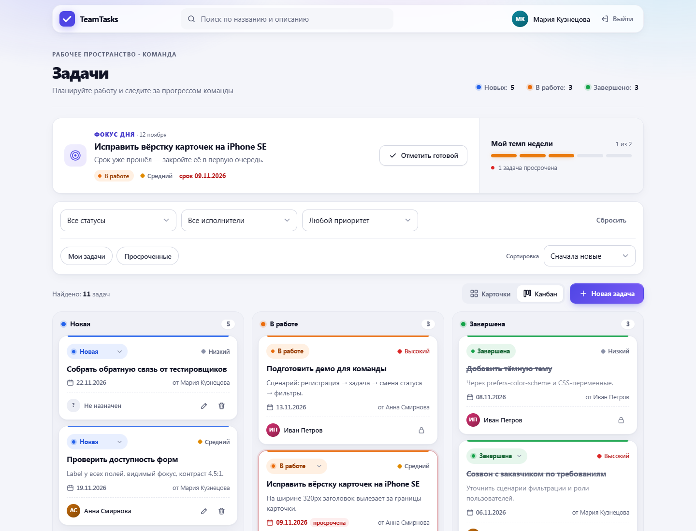
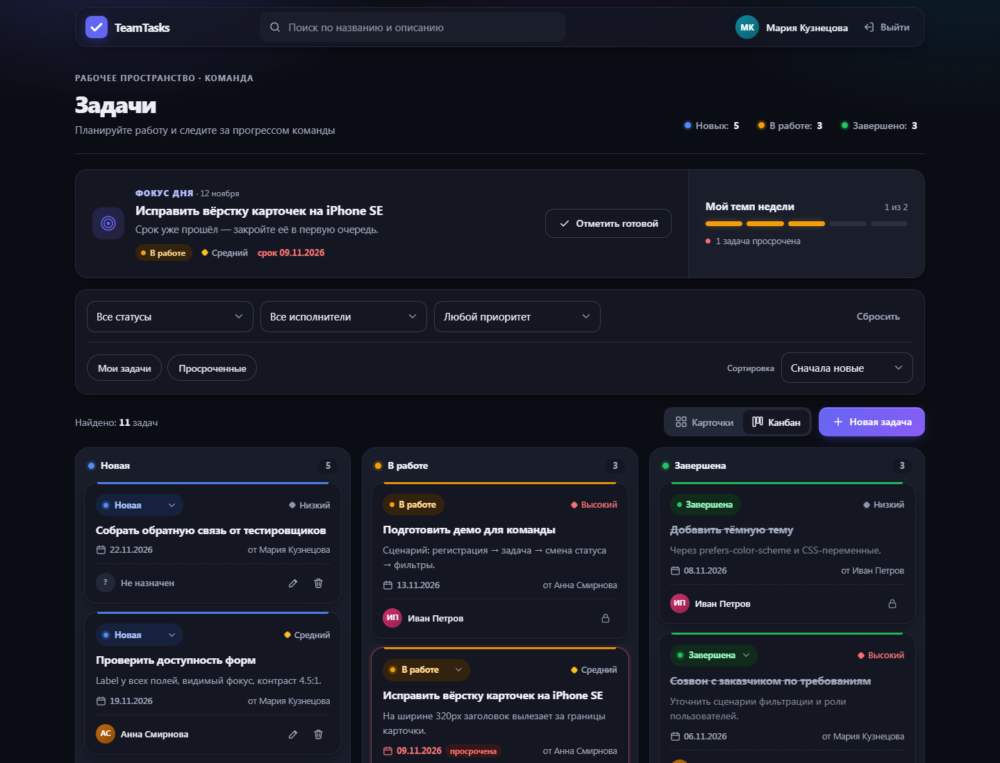
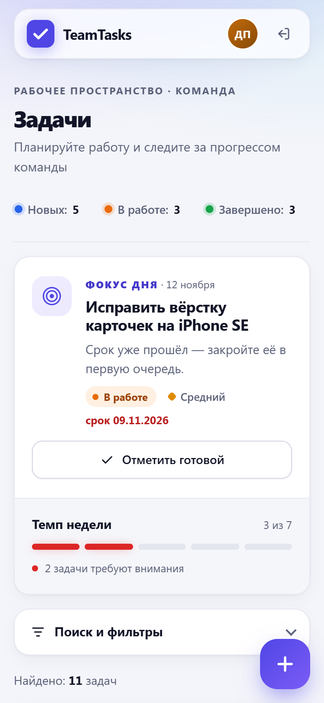
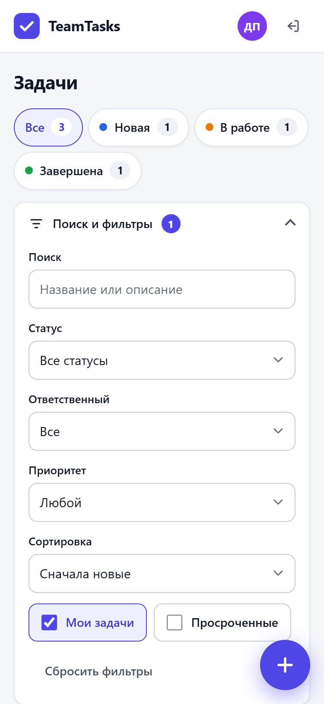
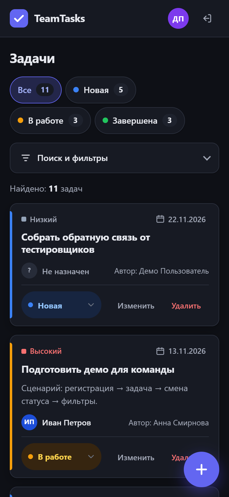
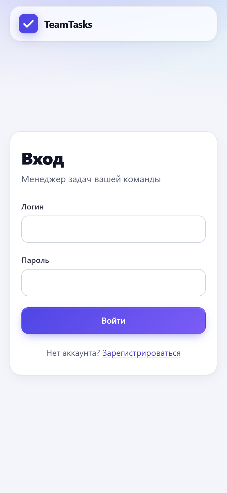

# TeamTasks — менеджер задач команды

Небольшое веб-приложение на чистом PHP: регистрация и вход, задачи с ответственными, статусами, приоритетами и сроками, поиск, фильтры и канбан-доска. Работает на ПК и телефоне, поддерживает тёмную тему и полностью работает без JavaScript (JS добавляет только удобство).

**Приложение:** https://YOUR-APP.onrender.com <!-- TODO: заменить после деплоя -->
**Демо-доступ:** `demo@example.com` / `demo12345`

| ПК: канбан | ПК: тёмная тема |
|---|---|
|  |  |

| Телефон: список | Телефон: фильтры | Телефон: тёмная тема | Телефон: вход |
|---|---|---|---|
|  |  |  |  |

Другие экраны: [список карточками](docs/screenshots/desktop-list.png), [форма задачи](docs/screenshots/desktop-form.png).

## Возможности

- **Авторизация:** регистрация (имя, email, пароль от 8 символов с подтверждением), вход и выход. Пароли хранятся через `password_hash`, после входа вызывается `session_regenerate_id(true)`. После 5 неудачных попыток вход блокируется на 60 секунд.
- **Задачи:** создание, редактирование, удаление с подтверждением (без JS работает через `<details>`). Поля: название, описание, ответственный, статус, приоритет, срок. В карточке указан автор.
- **Ответственный:** выбирается из списка пользователей или «Не назначен». В карточке показаны инициалы и имя.
- **Статусы:** «Новая» (синий), «В работе» (оранжевый), «Завершена» (зелёный). Статус меняется прямо в карточке: с JS через `fetch` без перезагрузки, без JS обычным POST с редиректом. В канбане карточку можно перетащить в другую колонку.
- **Поиск и фильтры:** поиск по названию и описанию (без учёта регистра, в том числе для кириллицы). Фильтры по статусу, ответственному и приоритету, «Мои задачи», «Просроченные». Сортировка по дате создания, сроку или приоритету. Все параметры хранятся в URL, есть кнопка «Сбросить фильтры», счётчик найденных задач и пустое состояние.
- **Счётчики по статусам** вверху страницы, они же служат быстрым фильтром.
- **Фокус дня:** одна задача, с которой стоит начать день. Сначала ваши задачи, затем без исполнителя; среди них просроченные, со сроком сегодня, с высоким приоритетом, с ближайшим сроком. Кнопка «Отметить готовой» работает без JS.
- **Мой темп недели:** личная шкала из 5 полос по задачам, где вы ответственный (как и в фокусе дня). Если в фильтре выбран другой исполнитель, фокус и темп показываются для него. Считается как «закрыто за неделю / (закрыто + открытые со сроком до воскресенья, включая просроченные)». 4–5 полос зелёные, 3 оранжевые, 1–2 красные. Рядом количество задач, требующих внимания. После смены статуса шкала обновляется без перезагрузки.
- **Интерфейс:** карточки на всех экранах, канбан из 3 колонок на ПК, тёмная тема по `prefers-color-scheme`, flash-сообщения, ошибки под полями с сохранением введённых значений, подсветка просроченных задач, даты в формате дд.мм.гггг.

## Стек и почему выбран

| Слой | Технология | Почему |
|---|---|---|
| Бэкенд | PHP 8.1+ без фреймворков | По заданию; маленькое приложение, весь код на виду: роутер, CSRF, сессии, валидация |
| Автозагрузка | Composer, PSR-4 | Стандарт; без `vendor/` срабатывает встроенный запасной автозагрузчик |
| БД | SQLite через PDO | Ноль настройки, один файл, достаточно для команды. MySQL подключается через DSN в `.env` |
| Шаблоны | Нативный PHP + `e()` | Без шаблонизатора; весь вывод экранируется `htmlspecialchars(ENT_QUOTES)` |
| Стили | Чистый CSS с переменными | Темизация и адаптив без сборки |
| JS | ~250 строк ванильного JS | Только прогрессивное улучшение: fetch для статусов, drag-and-drop, автоприменение фильтров |
| Деплой | Docker `php:8.2-apache` | Одинаково работает на Render, Railway и локально |

## Локальный запуск

Нужен PHP 8.1+ с расширениями `pdo_sqlite` и `mbstring`.

```bash
cp .env.example .env
php database/migrate.php && php database/seed.php && php -S localhost:8000 -t public
```

Откройте http://localhost:8000 и войдите как `demo@example.com` / `demo12345`.

- `composer install` необязателен: без него работает встроенный автозагрузчик.
- Если файла БД нет, таблицы создаются автоматически при первом запросе.
- `php database/seed.php --fresh` пересоздаёт демо-данные.
- **OSPanel 6:** в `.osp/project.ini` DocumentRoot уже указан на `public/`.

### Через Docker

```bash
docker build -t team-tasks .
docker run -p 8080:80 -v team-tasks-data:/var/www/html/storage team-tasks
```

## Деплой

### Render.com

1. Загрузите репозиторий на GitHub.
2. В Render: **New → Blueprint**, выберите репозиторий. Будет использован `render.yaml`: Docker-сервис и Persistent Disk на 1 ГБ, смонтированный в `/var/www/html/storage`.
3. При старте контейнер сам выполнит миграцию и сид (сид только в пустую БД), поэтому демо-вход сразу работает.

> Persistent Disk есть только на платных планах Render. На бесплатном плане файловая система сбрасывается при каждом деплое. Тогда подключите внешнюю MySQL через `DB_DSN`, `DB_USER`, `DB_PASS` или используйте Railway.

### Railway

New Project → Deploy from GitHub repo. Railway найдёт `Dockerfile`. Добавьте Volume с путём монтирования `/var/www/html/storage`. Порт берётся из `$PORT` автоматически.

### Обычный хостинг с Apache

Укажите DocumentRoot на `public/` и дайте права на запись в `storage/`. Если DocumentRoot изменить нельзя, корневой `.htaccess` перенаправит все запросы в `public/`, так что `src/`, `storage/` и `.env` снаружи будут недоступны.

### Переменные окружения

| Переменная | По умолчанию | Описание |
|---|---|---|
| `APP_ENV` | `production` | `local` — ошибки выводятся на экран, `production` — только в лог |
| `APP_URL` | `http://localhost:8000` | Публичный адрес |
| `APP_TIMEZONE` | `Europe/Moscow` | Часовой пояс для сроков и «просроченных» |
| `DB_DSN` | `sqlite:storage/database.sqlite` | Например, `mysql:host=…;dbname=…;charset=utf8mb4` |
| `DB_USER`, `DB_PASS` | пусто | Для MySQL |
| `APP_LOG` | `storage/logs/app.log` | Пустое значение — стандартный лог (stderr в Docker) |

## Структура проекта

```
public/            единственная публичная папка (DocumentRoot)
  index.php        точка входа и таблица маршрутов
  .htaccess        всё, кроме файлов, → index.php
  assets/          app.css, app.js, noscript.css, favicon.svg
src/
  bootstrap.php    автозагрузка, конфиг, настройка ошибок
  helpers.php      e(), config(), csrf_field(), format_date(), plural()…
  Core/            Router, Request, Response, Database, View, Session, Csrf, Auth, Validator, LoginThrottle
  Controllers/     AuthController, TaskController
  Models/          User, Task
views/             layout.php, auth/, tasks/, partials/, errors/
database/          schema.sql, schema.mysql.sql, migrate.php, seed.php
storage/           файл SQLite и логи (в .gitignore)
docker/            entrypoint.sh: порт из $PORT, миграция, сид, права
config.php, .env.example, Dockerfile, render.yaml, composer.json
```

## Маршруты

| Метод | URL | Действие |
|---|---|---|
| GET | `/` | редирект на `/tasks` или `/login` |
| GET/POST | `/login`, `/register` | вход, регистрация |
| POST | `/logout` | выход |
| GET | `/tasks` | список с фильтрами (`q`, `status`, `assignee`, `priority`, `mine`, `overdue`, `sort`, `view`) |
| GET | `/tasks/create` | форма создания |
| POST | `/tasks` | сохранить задачу |
| GET | `/tasks/{id}/edit` | форма редактирования |
| POST | `/tasks/{id}` | обновить задачу |
| POST | `/tasks/{id}/delete` | удалить задачу |
| POST | `/tasks/{id}/status` | сменить статус (HTML-редирект или JSON при `Accept: application/json`) |

Несуществующие страницы отдают 404 в общем дизайне, неверный метод — 405, POST без CSRF-токена — 419.

## Безопасность

- Все запросы к БД — prepared statements. Сортировка берётся из белого списка, фильтры нормализуются (неизвестные значения отбрасываются).
- Весь вывод экранируется через `e()`; Content-Security-Policy запрещает inline-скрипты и стили.
- CSRF-токен на всех POST-запросах; `fetch` передаёт его в заголовке `X-CSRF-Token`; сравнение через `hash_equals`.
- Cookie сессии: `HttpOnly`, `SameSite=Lax`, `Secure` при HTTPS (учитывается `X-Forwarded-Proto` за прокси Render). Включён `session.use_strict_mode`.
- Перебор паролей ограничен по паре «IP + email» в БД, поэтому сброс cookie не помогает.
- Адрес возврата после действий проверяется (только `/tasks…`), открытого редиректа нет.
- В продакшене `display_errors` выключен, ошибки и исключения пишутся в лог, пользователь видит страницу 500. Любой warning превращается в исключение, поэтому незамеченных предупреждений нет.

## Самопроверка по критериям приёмки

- [x] Регистрация, вход и выход работают; без входа `/tasks` перенаправляет на `/login`.
- [x] Задачи создаются, редактируются и удаляются.
- [x] Ответственного можно назначить, сменить и снять.
- [x] Три статуса; смена работает с JS (fetch, JSON) и без него (POST и редирект).
- [x] Поиск и фильтры комбинируются и сохраняются в URL.
- [x] Данные в SQLite сохраняются после перезагрузки страницы и перезапуска сервера.
- [x] При ширине 320, 375, 768, 1024 и 1440px горизонтальной прокрутки нет (проверено в headless Chrome).
- [x] `<script>alert(1)</script>` выводится как текст, `' OR 1=1 --` ищется как обычная строка, POST без CSRF-токена получает 419.
- [x] `php -l` проходит без ошибок, в логах нет warnings (проверено на PHP 8.2 и 8.5).
- [ ] Приложение задеплоено, ссылка указана выше.

## Процесс разработки

<!-- TODO: подставьте точные формулировки 4 вопросов из задания и при необходимости поправьте ответы -->

### 1. Какие инструменты использовались

Приложение написано с помощью Claude Code (ИИ-ассистент в VS Code) по заранее составленному ТЗ. Локально использовались PHP 8.2 из OSPanel, встроенный сервер `php -S`, curl для сквозной проверки маршрутов и headless Chrome для скриншотов и проверки вёрстки на разных ширинах.

### 2. Как была организована работа

Работа шла по плану из ТЗ: каркас (роутер, View, конфиг) → БД, миграции и сид → авторизация → CRUD → быстрая смена статуса → фильтры → дизайн, адаптив и JS → безопасность и страницы ошибок → Docker и README. После каждого этапа запускались `php -l` и сценарий на curl: гость, вход, CRUD, XSS, SQL-инъекция, CSRF, блокировка перебора, открытый редирект.

### 3. Какие возникли сложности и как они решены

- **Поиск по кириллице без учёта регистра.** `LOWER()` в SQLite понимает только ASCII. Решение: зарегистрирована PHP-функция `ulower` на основе `mb_strtolower`; для MySQL используется обычный `LOWER`.
- **Строгий CSP против inline-стилей.** Цвет аватара сначала задавался через `style="--hue:…"`, и CSP его блокировал. Перешёл на набор CSS-классов.
- **Приложение без JS.** Подтверждение удаления сделано на `<details>`. Кнопка «Сменить» у статуса показывается только без JS, через `<noscript><link rel=stylesheet>`. Фильтры применяются кнопкой, а с JS — сразу при изменении.
- **Совместимость с PHP 8.4+.** `PDO::sqliteCreateFunction` объявлен устаревшим, поэтому используется `PDO::connect()` с `createFunction`.

### 4. Что можно улучшить

Роли и права (например, удаляет только автор), комментарии и история изменений задачи, пагинация для больших списков, уведомления о приближении срока, автотесты на PHPUnit и CI в GitHub Actions.
